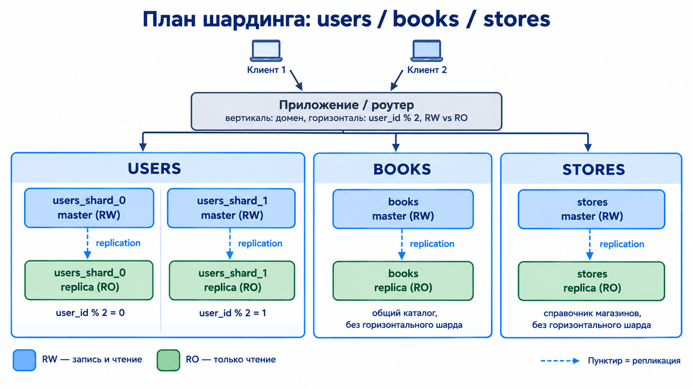

# Домашнее задание к занятию "Репликация и масштабирование. Часть 2" - Шонгин Егор

## Задание 1

1. **Активный master-сервер и пассивный slave-сервер**  
Главное преимущество этой схемы - высокая доступность и надежность. Пассивный slave работает как "горячий резерв", он постоянно синхронизируется с мастером, но не принимает нагрузку от пользователей. Если основной master-сервер выходит из строя, например, при аппаратном сбое, то администратор может практически мгновенно переключить трафик на slave, минимизируя время простоя. Также такой slave идеально подходит для создания резервных копий без остановки основного сервиса
1. **Master-сервер и несколько slave-серверов**  
Здесь ключевое преимущество - масштабируемость чтения и распределение нагрузки. В большинстве веб-приложений операций чтения (SELECT) в разы больше, чем записи (INSERT/UPDATE). Мастер берет на себя все операции записи, а множество слейвов параллельно обрабатывают потоки запросов на чтение. Это позволяет системе выдерживать огромную нагрузку, которую не потянул бы один сервер. Кроме того, разные слейвы можно использовать для разных целей: один обслуживает сайт, второй тяжелую аналитику и отчеты, третий бэкапы. Это изолирует ресурсоемкие задачи и гарантирует, что генерация сложного отчета не положит основной сайт

## Задание 2

### Вертикальный шардинг
Разделяю все 3 базы данных на разные сервера

| Сервер | БД |
| --- | --- |
| Сервер 1 | users |
| Сервер 2 | books |
| Сервер 3 | stores |

Сделано это с той целью, что на все эти базы данных будет приходиться разная нагрузка
- **users** - постоянно изменяется, так как пользователи регистрируются и меняют свои личные данные
- **books** - изменяется реже, а вот чтение данных здесь происходит постоянно
- **stores** - строк мало, изменения происходят редко, но чтение данных постоянно

Также такой подход увеличит доступность и устойчивость, например, если Сервер 3 упадет, то информация по магазинам станет недоступна, но пользователи все равно смогут регистрироваться и смотреть каталог книг

### Горизонтальный шардинг
Горизонтальное разделение лучше всего подойдет для таблицы с пользователями. Разделю users на два шарда:
- **users_shard_0** - пользователи с чётным user_id (user_id % 2 = 0)
- **users_shard_1** - с нечётным (user_id % 2 = 1)

Если пользователей станет слишком много, то можно будет добавить еще один шард и перенести туда часть данных

### Итоговая блок-схема

